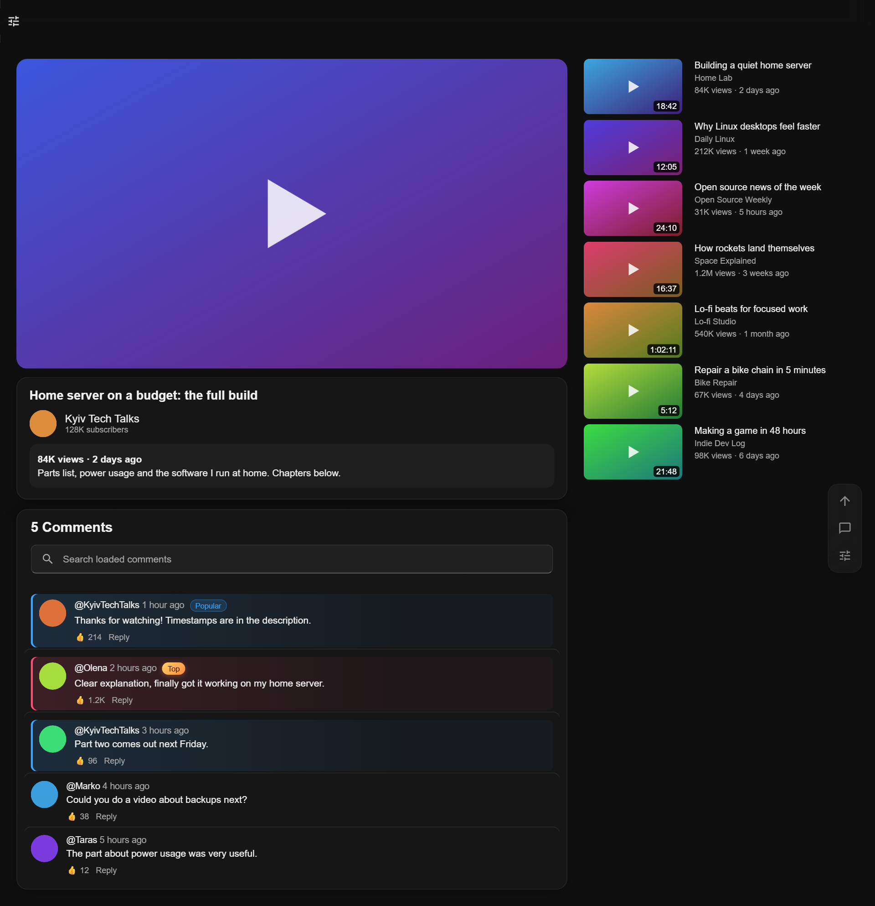
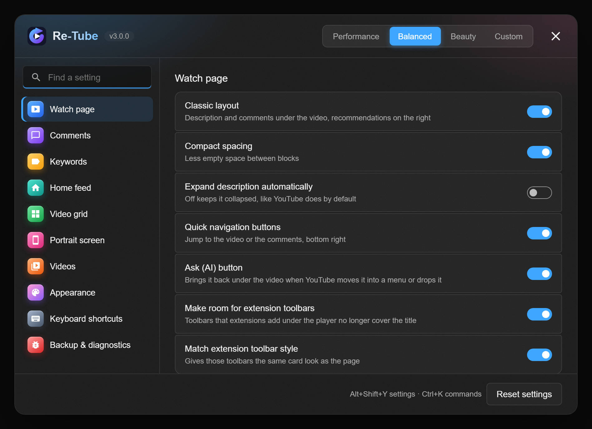

<p align="center">
  
</p>

<p align="center">
  <a href="https://github.com/kYaRick/re-tube/actions/workflows/ci.yml"></a>
  <a href="https://github.com/kYaRick/re-tube/releases/latest"></a>
  <a href="LICENSE"></a>
</p>

<p align="center">
  <b>Re-Tube</b> (Restore YouTube) restores YouTube's classic watch layout and adds power-user tools for comments, feeds, and subscriptions.
</p>

## ✨ Highlights

- 🎬 **Classic layout:** description and comments under the video, recommendations on the right.
- 🎨 **Presets:** switch between Performance, Balanced, or Beauty in one click, then fine-tune anything.
- 📺 **Subscriptions window:** view every channel in one searchable grid, sorted by latest uploads.
- ⌨️ **Command palette:** press <kbd>Ctrl</kbd>+<kbd>K</kbd> to jump to any setting or action.
- 💬 **Comment tools:** highlight creator, pinned, and hearted comments; filter by Top, Popular, search, or spam.
- 🛡️ **Clean feeds:** hide Shorts, Playables, and unused shelves with a responsive video grid.

<p align="center">
  
</p>

<p align="center">
  
</p>

<p align="center"><sub>Screenshots use a mock page with made-up channels.</sub></p>

## 📥 Install

Re-Tube is a userscript. It runs in any of these hosts:

| Host | How | Auto-update |
| --- | --- | --- |
| [Violentmonkey](https://violentmonkey.github.io/) | Open [`retube.user.js`](https://github.com/kYaRick/re-tube/releases/latest/download/retube.user.js) and confirm | ✅ Yes |
| [Tampermonkey](https://www.tampermonkey.net/) | Open [`retube.user.js`](https://github.com/kYaRick/re-tube/releases/latest/download/retube.user.js) and press **Install** | ✅ Yes |
| [Enhancer for YouTube](https://www.mrfdev.com/enhancer-for-youtube) | Paste the code into **Custom script**, save, select automatic run, reload YouTube | ❌ No, paste each new version |

On YouTube, press <kbd>Alt</kbd>+<kbd>Shift</kbd>+<kbd>Y</kbd> for settings. Turn on Re-Tube in one host only: two copies conflict.
Step-by-step guide with screenshots: [Install](https://kyarick.github.io/re-tube/install/).

Upgrading from "YouTube Classic+"? Re-Tube replaces it and keeps your settings.

## 📚 Documentation

[kyarick.github.io/re-tube](https://kyarick.github.io/re-tube/) · [Українська](https://kyarick.github.io/re-tube/uk/)

## 💻 Development

Requires [Bun](https://bun.sh) and [just](https://just.systems).

```bash
just setup       # install dependencies
just dev         # dev server for Violentmonkey
just e2e-setup   # install Playwright browsers (once)
just ci          # lint, types, tests, build, docs
```

Read the [Architecture guide](https://kyarick.github.io/re-tube/dev/architecture/) before adding a feature.

## 📄 License

[GPL-3.0](LICENSE)


---

<p align="center">✨ Made with love to 💛Ukraine💙</p>
