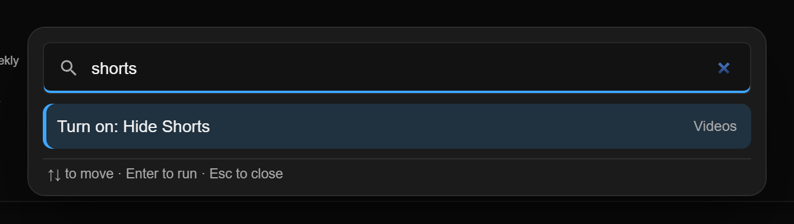

Press <kbd>Ctrl</kbd>+<kbd>K</kbd> (<kbd>Cmd</kbd>+<kbd>K</kbd> on macOS) or <kbd>Alt</kbd>+<kbd>Shift</kbd>+<kbd>K</kbd> on any YouTube page.

Type a few letters of what you want. Every word you type must appear in the command, its hint or its keywords, so `hide shorts`, `shorts` and `sho hi` all find **Turn on: Hide Shorts**.

| You type | You get |
|---|---|
| `settings` | Open the settings window |
| `subs` | The [subscriptions window](../subscriptions/) |
| `preset perf` | Apply the Performance preset |
| `comments` | Go to comments (on a video page), comment settings |
| `blur` or `fluent` | Turn the Fluent style on or off |
| `reload` | Reload the page |

<kbd>↓</kbd> and <kbd>↑</kbd> move, <kbd>Enter</kbd> runs, <kbd>Esc</kbd> closes.

<kbd>Ctrl</kbd>+<kbd>K</kbd> is not taken while you type in a text field, such as YouTube's search box; <kbd>Alt</kbd>+<kbd>Shift</kbd>+<kbd>K</kbd> always works.

Turn the palette off in **Keyboard shortcuts > Command palette**.
