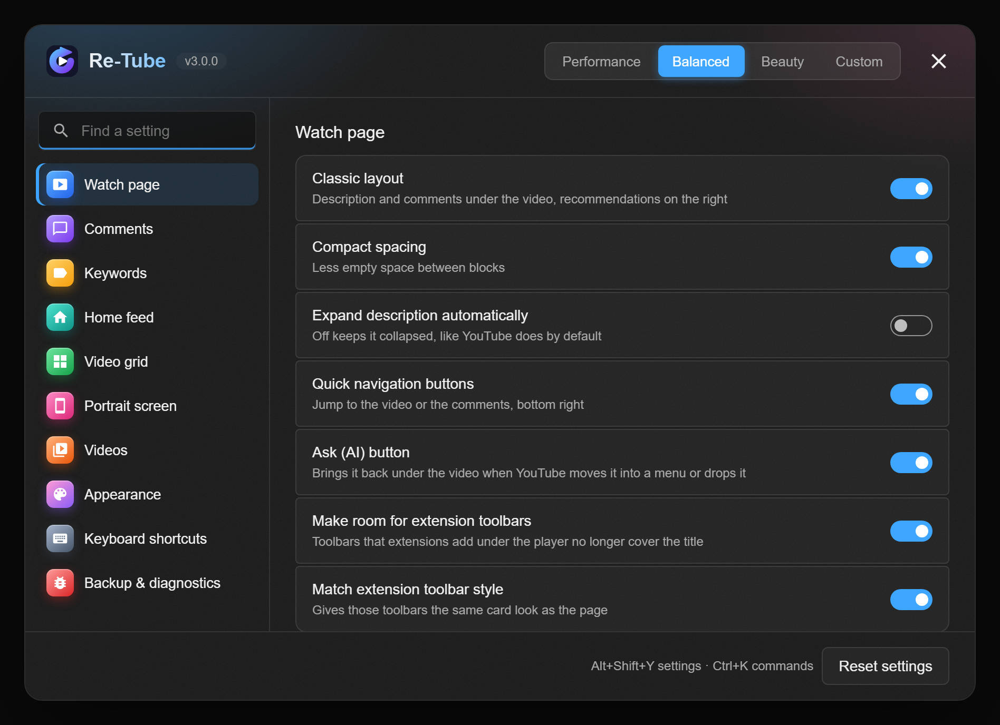
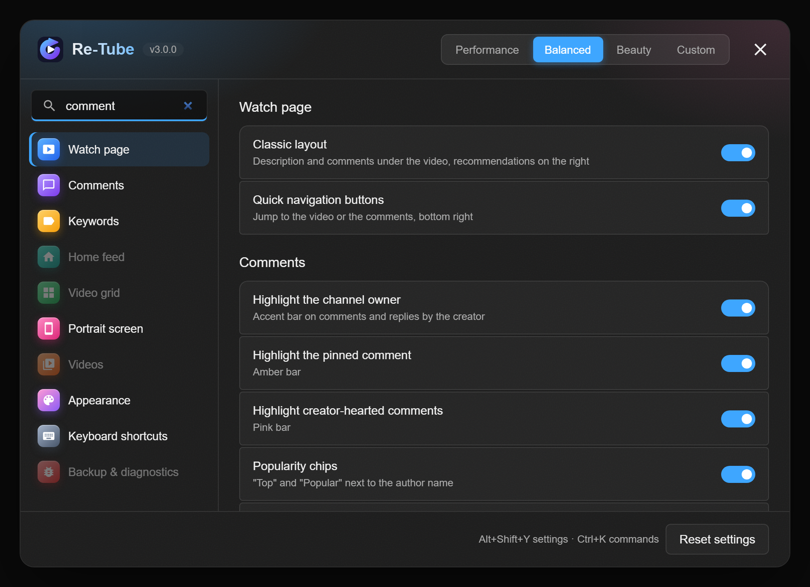

## 🔓 Open the window

- Press <kbd>Alt</kbd>+<kbd>Shift</kbd>+<kbd>Y</kbd> on any YouTube page.
- Or click the Re-Tube logo in the YouTube header.
- Or press <kbd>Ctrl</kbd>+<kbd>K</kbd> and run **Open settings** from the [command palette](../command-palette/).

Changes apply at once. **Classic layout** and **Ambient glow** need a page reload; the window shows a **Reload** button when that is the case.

## 🧩 Layout

- **Header:** the [preset](../presets/) switch: Performance, Balanced, Beauty, or Custom.
- **Left:** the sections and a search box. Use the arrow keys to move between sections.
- **Right:** the settings of the selected section.

Type in the search box to see matching settings from every section at once. Sections without matches are dimmed.

| Section | What it controls |
|---|---|
| Watch page | Classic layout, compact spacing, description, navigation buttons, Ask button, extension toolbars |
| Comments | Creator, pinned and hearted highlights, popularity chips, comment search |
| Keywords | Words that highlight a comment, words that hide it, spam filter |
| Home feed | Subscriptions window, Shorts and feed sections |
| Video grid | Videos per row: automatic, fixed or YouTube's default |
| Portrait screen | Single-column mode and collapsed comments |
| Videos | Watched badge, dim watched videos, smaller thumbnails |
| Appearance | Animations, ambient glow, Fluent look, cursor light, card layout, accent colour |
| Keyboard shortcuts | Command palette and the list of shortcuts |
| Backup & diagnostics | Export, import, reset, Copy diagnostics |

## ⌨️ Keyboard shortcuts

| Keys | Action |
|---|---|
| <kbd>Ctrl</kbd>+<kbd>K</kbd> or <kbd>Alt</kbd>+<kbd>Shift</kbd>+<kbd>K</kbd> | Command palette |
| <kbd>Alt</kbd>+<kbd>Shift</kbd>+<kbd>Y</kbd> | Open or close settings |
| <kbd>Alt</kbd>+<kbd>Shift</kbd>+<kbd>C</kbd> | Go to comments |
| <kbd>Alt</kbd>+<kbd>Shift</kbd>+<kbd>V</kbd> | Back to the video |
| <kbd>Alt</kbd>+<kbd>Shift</kbd>+<kbd>R</kbd> | Go to recommendations (portrait mode) |
| <kbd>Esc</kbd> | Close the window or clear the comment search |

## 💾 Storage

Settings are saved in the browser's `localStorage` for `www.youtube.com`, under the key `ytc:settings:v2`.
To move them to another browser, use **Export** and **Import** in **Backup & diagnostics**.

## ⚙️ Advanced configuration

Spam patterns, "Ask" button labels, hidden-section rules and grid limits live in `src/core/config.ts`.
Change them there and build your own copy. See [Architecture](../dev/architecture/).
