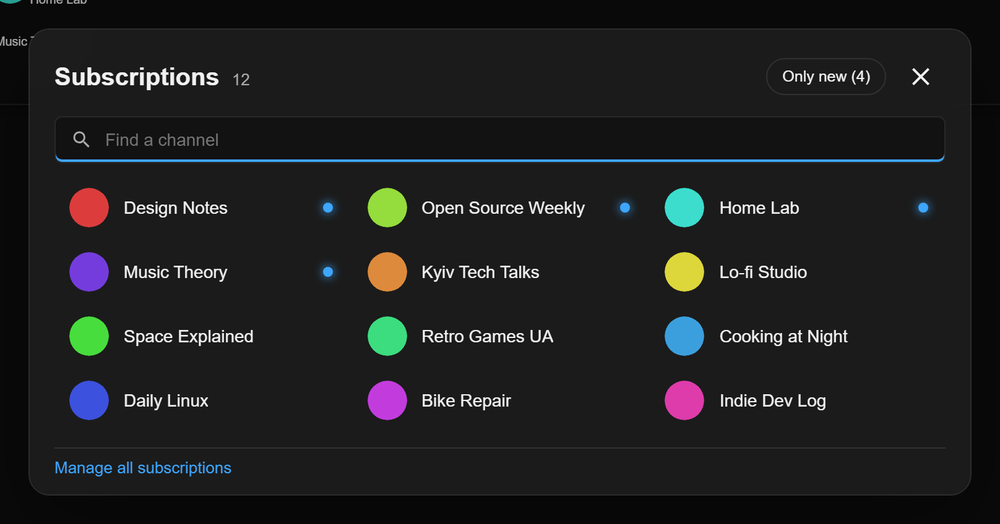

The left menu shows only a few subscriptions. Re-Tube opens all of them in one window instead.

## 🔓 Open it

- Click **Show more** under your subscriptions in the left menu.
- Or click the **Subscriptions** header of that section.
- Or press <kbd>Ctrl</kbd>+<kbd>K</kbd> and run **Subscriptions**.

## 💡 Use it

- Type to filter. The search ignores case and works with any alphabet.
- <kbd>↓</kbd> and <kbd>↑</kbd> move through the channels, <kbd>Enter</kbd> opens one, <kbd>Esc</kbd> closes the window.
- Channels with new videos come first and have a dot. **Only new** shows just those.
- **Manage all subscriptions** opens YouTube's full list.

Channels open through YouTube's own navigation, without a page reload.

## ⚙️ Turn it off

**Home feed > Subscriptions window** in the settings. **Show more** then expands the menu as usual.

## 🛠️ If something is missing

The window reads the channels from YouTube's left menu. If channels or dots are missing, open the settings, press **Copy diagnostics** in **Backup & diagnostics** and attach the report to an issue. The `guide` and `guideEntry` blocks describe the menu structure without channel names.
