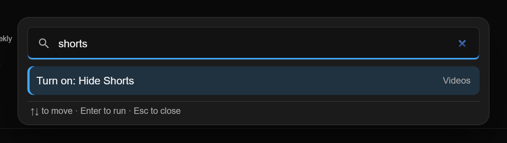

Натисніть <kbd>Ctrl</kbd>+<kbd>K</kbd> (<kbd>Cmd</kbd>+<kbd>K</kbd> на macOS) або <kbd>Alt</kbd>+<kbd>Shift</kbd>+<kbd>K</kbd> на будь-якій сторінці YouTube.

Введіть кілька літер потрібного запиту. Кожне слово має бути присутнє в назві команди, підказці або ключових словах, тому `hide shorts`, `shorts` і `sho hi` однаково знайдуть **Turn on: Hide Shorts**.

| Ви вводите | Результат |
|---|---|
| `settings` | Відкрити вікно налаштувань |
| `subs` | Відкрити [вікно підписок](../subscriptions/) |
| `preset perf` | Застосувати пресет Performance |
| `comments` | Перейти до коментарів (на сторінці відео) або налаштування коментарів |
| `blur` або `fluent` | Увімкнути або вимкнути стиль Fluent |
| `reload` | Перезавантажити сторінку |

<kbd>↓</kbd> та <kbd>↑</kbd> переміщують курсор, <kbd>Enter</kbd> виконує дію, <kbd>Esc</kbd> закриває вікно.

<kbd>Ctrl</kbd>+<kbd>K</kbd> не перехоплюється під час введення в текстовому полі (наприклад, у пошуку YouTube); комбінація <kbd>Alt</kbd>+<kbd>Shift</kbd>+<kbd>K</kbd> працює завжди.

Вимкнути палітру можна в розділі **Keyboard shortcuts > Command palette**.
