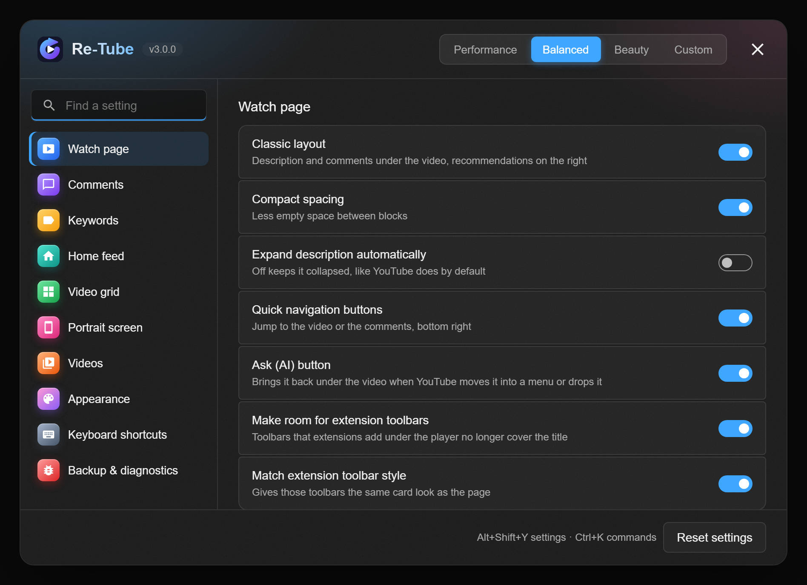
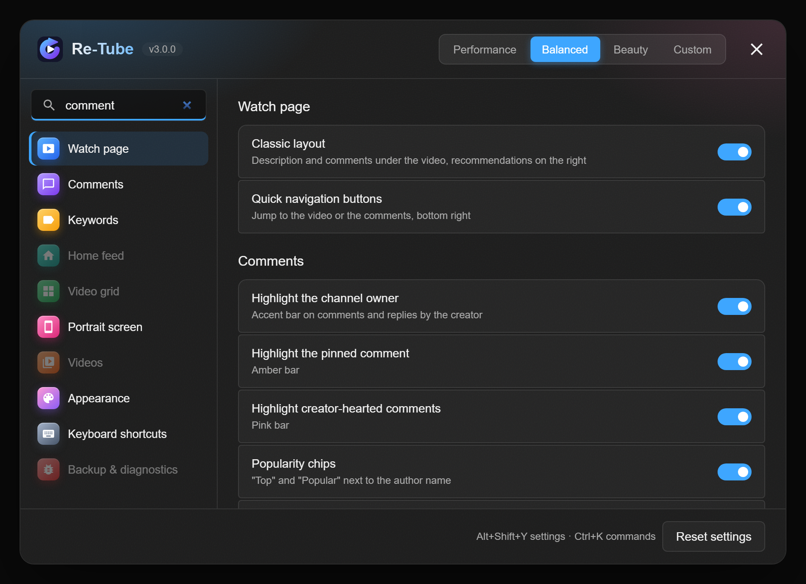

## 🔓 Як відкрити

- Натисніть <kbd>Alt</kbd>+<kbd>Shift</kbd>+<kbd>Y</kbd> на будь-якій сторінці YouTube.
- Або клацніть лого Re-Tube у хедері YouTube.
- Або натисніть <kbd>Ctrl</kbd>+<kbd>K</kbd> і виберіть **Open settings** у [палітрі команд](../command-palette/).

Зміни діють одразу. **Classic layout** і **Ambient glow** потребують перезавантаження сторінки; тоді у вікні з'являється кнопка **Reload**.

## 🧩 Будова вікна

- **Хедер:** перемикач [пресетів](../presets/): Performance, Balanced, Beauty або Custom.
- **Ліворуч:** розділи й пошук. Між розділами можна рухатися стрілками.
- **Праворуч:** налаштування вибраного розділу.

Пошук показує збіги з усіх розділів одночасно. Розділи без збігів тьмяніють.

| Розділ | За що відповідає |
|---|---|
| Watch page | Класичний макет, компактні відступи, опис, кнопки навігації, кнопка Ask, панелі розширень |
| Comments | Підсвітка автора, закріплених і відзначених коментарів, чипи популярності, пошук |
| Keywords | Слова підсвітки, стоп-слова, фільтр спаму |
| Home feed | Вікно підписок, Shorts та полиці стрічки |
| Video grid | Кількість відео в рядку: автоматично, фіксовано або стандарт YouTube |
| Portrait screen | Одноколонковий режим та згортання коментарів |
| Videos | Позначка Watched, приглушення переглянутого, менші мініатюри |
| Appearance | Анімації, ambient-підсвітка, Fluent-стиль, світло за курсором, картки, акцентний колір |
| Keyboard shortcuts | Палітра команд та список гарячих клавіш |
| Backup & diagnostics | Експорт, імпорт, скидання, Copy diagnostics |

## ⌨️ Гарячі клавіші

| Клавіші | Дія |
|---|---|
| <kbd>Ctrl</kbd>+<kbd>K</kbd> або <kbd>Alt</kbd>+<kbd>Shift</kbd>+<kbd>K</kbd> | Палітра команд |
| <kbd>Alt</kbd>+<kbd>Shift</kbd>+<kbd>Y</kbd> | Відкрити або закрити налаштування |
| <kbd>Alt</kbd>+<kbd>Shift</kbd>+<kbd>C</kbd> | До коментарів |
| <kbd>Alt</kbd>+<kbd>Shift</kbd>+<kbd>V</kbd> | Назад до відео |
| <kbd>Alt</kbd>+<kbd>Shift</kbd>+<kbd>R</kbd> | До рекомендацій (вертикальний режим) |
| <kbd>Esc</kbd> | Закрити вікно або очистити пошук у коментарях |

## 💾 Де зберігаються

У `localStorage` браузера для `www.youtube.com`, ключ `ytc:settings:v2`.
Щоб перенести в інший браузер, використайте **Export** та **Import** у розділі **Backup & diagnostics**.

## ⚙️ Розширене налаштування

Шаблони спаму, мітки кнопки "Ask", правила прихованих полиць та обмеження сітки знаходяться у `src/core/config.ts`.
Змініть їх там і зберіть власну копію. Див. [Архітектура](../dev/architecture/).
