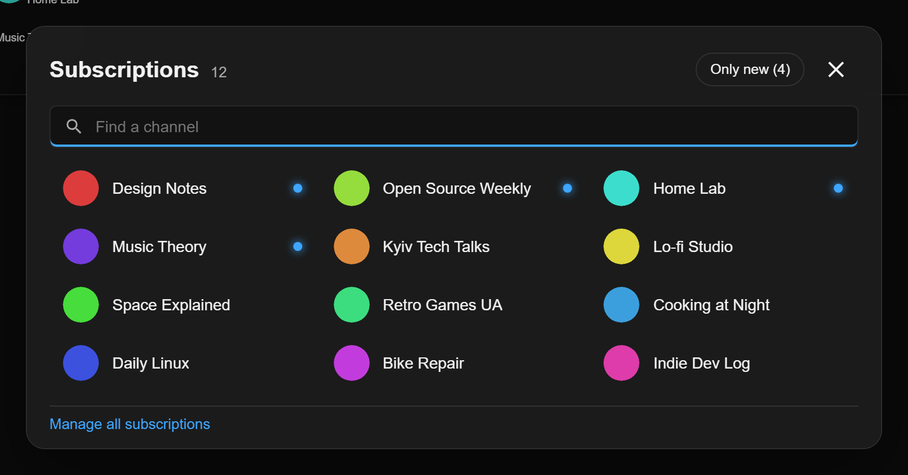

Ліве меню YouTube показує лише частину підписок. Re-Tube відкриває всі канали в одному вікні.

## 🔓 Як відкрити

- Натисніть **Show more** під списком підписок у лівому меню.
- Або клацніть на заголовок **Subscriptions** цього розділу.
- Або натисніть <kbd>Ctrl</kbd>+<kbd>K</kbd> і виберіть **Subscriptions**.

## 💡 Використання

- Почніть вводити текст для фільтрації. Пошук нечутливий до регістру і працює з будь-якою абеткою.
- <kbd>↓</kbd> та <kbd>↑</kbd> переміщують вибір між каналами, <kbd>Enter</kbd> відкриває канал, <kbd>Esc</kbd> закриває вікно.
- Канали з новими відео йдуть першими та мають крапку. Перемикач **Only new** показує лише їх.
- **Manage all subscriptions** відкриває повний список підписок на YouTube.

Канали відкриваються через вбудовану навігацію YouTube без перезавантаження сторінки.

## ⚙️ Як вимкнути

**Home feed > Subscriptions window** у налаштуваннях. Після цього **Show more** розгортатиме меню як зазвичай.

## 🛠️ Якщо чогось бракує

Вікно зчитує канали з лівого меню YouTube. Якщо канали або крапки відсутні, відкрийте налаштування, натисніть **Copy diagnostics** у розділі **Backup & diagnostics** і прикріпіть звіт до звернення. Блоки `guide` та `guideEntry` описують структуру меню без назв каналів.
